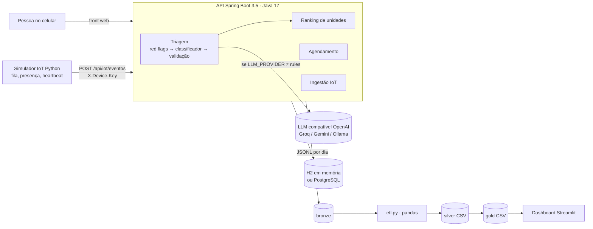
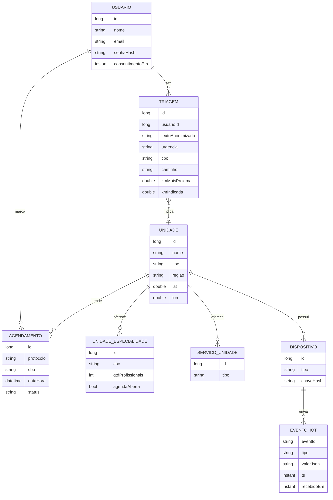

# Arquitetura do PertoDeMim

## Visão geral



## Fluxo principal (a demonstração do pitch)

```mermaid
sequenceDiagram
    participant S as Simulador
    participant A as API
    participant U as Pessoa
    S->>A: presença do ortopedista = ausente (unidade mais próxima)
    U->>A: "quebrei a perna" (triagem)
    A->>A: red flags (não) → classificador → Ortopedia, laranja
    A->>A: ranking: online + tem ortopedista + distância/espera
    A-->>U: unidade certa (mais longe) e aviso de que a mais próxima não tem
    U->>A: agendar horário
    A->>A: grava agendamento e evento no bronze
    Note over A: ETL gera os indicadores; o dashboard mostra km evitados
```

## Camadas da triagem

1. `RedFlagDetector`: regras fixas; vermelho vai direto para 192 (188 em ideação suicida) sem chamar o LLM.
2. Classificador: `RegrasClassificador` (padrão) ou `OpenAiCompatProvider`.
3. `RespostaLlmParser`: valida o JSON, lista fechada de 12 especialidades (CBO), texto de orientação do app, piso de urgência (o LLM não rebaixa laranja ou pior). Falha cai nas regras.

## Ranking

Elegível: unidade online (heartbeat com menos de 2 min) **e** que oferece o serviço **e** (profissional presente com check-in de menos de 4 h **ou** agenda aberta).

`score = 0,5·distância/distMax + 0,3·espera/esperaMax + 0,2·penalidade(latência/2000)`

Ordem: unidades com o profissional agora, depois as de agenda, depois até 3 rebaixadas (sem confirmação recente) mais próximas que a melhor. Sem nenhuma elegível, mostra as 5 mais próximas com aviso. A resposta traz `kmIndicada` e `kmMaisProxima` para medir o ganho.

## Modelo de dados (API, simplificado: só os campos principais)



## Camadas de dados (medalhão)

| Camada | Conteúdo | Regra |
|---|---|---|
| bronze | JSONL por dataset e dia (`iot`, `triagens`, `agendamentos`), campo `origem` = `api` ou `exemplo` | só acrescenta |
| silver | CSV validado e deduplicado por `origem|id`, horário local de São Paulo; `rejeitados.csv` com o motivo | recalculado inteiro a cada execução (idempotente) |
| gold | `g_espera`, `g_cobertura_especialidade`, `g_demanda`, `g_impacto`, `g_conectividade`, `g_pressao` | tabelas prontas para o dashboard |

## Decisões e limites

- Spring Boot na API (stack do curso); Python só em ETL, dashboard e simulador.
- H2 em memória por padrão para rodar sem instalar nada; PostgreSQL por variáveis de ambiente.
- Sem hardware: o simulador produz os mesmos eventos que um sensor real enviaria, com autenticação por chave.
- A checagem de capacidade do agendamento e o limite de requisições são locais a uma instância (ver `area4_devops/SEGURANCA.md` e o README).
